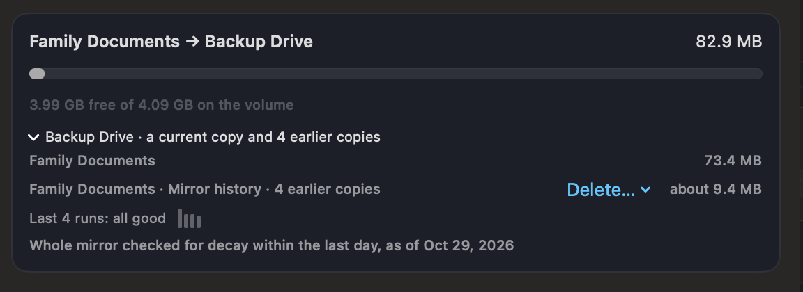
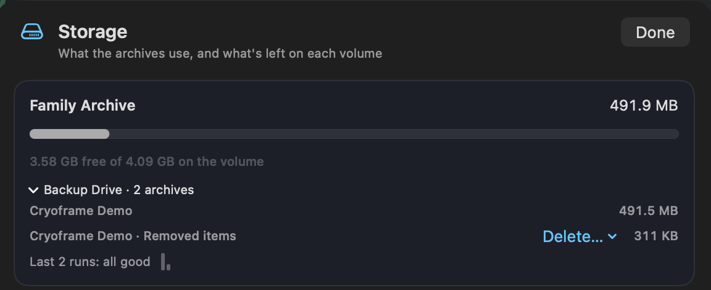
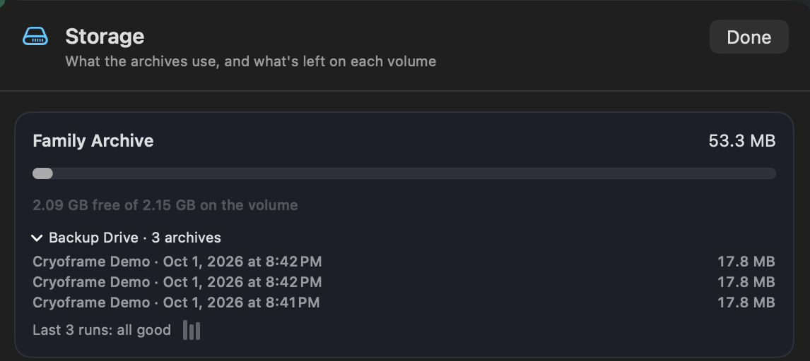

# Versions, retention, and storage

[← Back to contents](README.md)

A job that keeps dated versions keeps a history. Each run is its own dated version, so you can restore a library as it was at a point in time. This page covers how versions accumulate, how to cap them, and how to watch the disk space they use.

## Versions

Every run of a job that keeps dated versions (as disk images or zip files) writes a new version into a dated folder under the destination, named by the date and time of the run. The Restore window lists each version with its date, so you pick the point in time you want.

A job that keeps one up-to-date copy (a live mirror or plain files) works differently. Each run updates that copy in place. A live mirror on an APFS drive keeps a short history of its own (see [Mirror history](#mirror-history)); plain files keep none. For a long history, or one on another drive, keep dated versions.

## Mirror history

A live mirror keeps the copy from each of the last 7 nights, unless you change it. In the job editor, under Keep, Keep history offers Off, 7, 14 or 30 nights. It applies to mirror jobs made before 1.8 too. If a job runs more than once a night, only the last copy of each night is kept. The count is of days a run made a copy, so a weekly job set to 7 keeps about seven weeks.

Each copy is an APFS clone of the mirror's disk image, kept in a folder named "Mirror history" beside it. A clone shares everything that hasn't changed since, so a night's copy takes about what changed in the library that night. A library rewritten every night, such as one whole large database file, costs its full size each night.

History only protects against deletes and bad updates. The copies are on the same drive as the mirror and share its data, so they don't help if the drive fails, is lost, or decays. If decay is found in the mirror, Cryoframe says that its history may hold the same damage.

When the drive runs short of room, the mirror comes first: the oldest copies are deleted until the run fits, and the run's history says what went. A run that finds decay in the mirror adds no copy. Going back to Cryoframe 1.7.0 deletes no history and makes no new copies, but 1.7.0 drops the Keep history setting, so check it when you return to 1.8; see [Going back to 1.7.0](updating-troubleshooting.md#going-back-to-170).

History needs an APFS drive connected to this Mac whose volume can make clones. It isn't kept on exFAT, FAT32 or Mac OS Extended drives, on network drives, or in iCloud Drive, Dropbox and other cloud folders, which would upload a whole copy for every night. The job editor says which destinations can't keep it, and why. See [Formats and destinations](formats-and-destinations.md).

## Retention

Keeping every version forever fills a disk. A new job that keeps dated versions keeps **the last 7**, which bounds it. The Keep setting in the job editor changes that when you make the job or any time after:

- The last few: the last N versions (7 by default).
- Every version: unbounded, so watch the destination.
- Daily, weekly and monthly: a grandfather-father-son scheme, which thins older versions while keeping long-range coverage.

Jobs made before this was the default keep whatever you chose then, including "keep all". Cryoframe will tell you if one of them is growing with nothing to stop it, and how much keeping only the recent versions would give back.

After each run, Cryoframe prunes the versions the policy no longer keeps. Only a complete version with a checksum manifest counts toward the policy. A version left half-written by a failed or canceled run is swept away and never occupies a slot that would push out a good archive.

Messages attachments are an exception to pruning. Before pruning deletes the last version that holds a file you deleted in Messages, Cryoframe saves that file in a removed-items archive, and the Keep rule never deletes those archives. If one can't be built, the versions it would have saved from are kept, and the run says so. See [Messages attachments](formats-and-destinations.md#messages-attachments).

## Backups from an earlier version

When a job takes over a folder an earlier version of Cryoframe made, or you move versions into its folder, the job didn't make those versions, so its Keep rule doesn't apply to them yet. They are kept, and never deleted, until you say otherwise.

Each backup counts how many of them the Keep rule would delete, and the main window shows a card for each such folder: how many earlier backups are kept for now, and a button, "Let Keep apply, and delete N". Only after you click it can those versions be deleted, and only the ones it counted. The editor's Save summary and a new job's first-backup summary offer the same choice.

Under "The last few", one go-ahead covers the versions later backups push out one at a time, so you aren't asked every night. Under "Daily, weekly and monthly", each backup asks again. If you change the Keep rule, any go-ahead you gave is withdrawn and the count is made again. The version that last passed a restore drill is never deleted, whatever you agreed to.

If you go back to Cryoframe 1.5.6 and then return to 1.6, the go-aheads are lost: you are asked again, and nothing is deleted meanwhile.

## Kept versions

A version marked "Kept" in Restore and Storage is one a job no longer manages, usually because the job changed between one up-to-date copy and dated versions. The versions in its folder from before the change, and a mirror left behind, are kept, and Cryoframe never deletes them. Restore has no delete action, so to remove one you no longer need, quit Cryoframe and delete that version's folder (or the left-behind mirror image) in Finder. The background agent still runs scheduled jobs while Cryoframe is closed, so first choose Disable schedule in the job's ⋯ menu, and Enable schedule once you're done.

## When a destination is filling up

A full destination doesn't slow backups down, it stops them: the run fails on a free-space check and every run after it fails the same way, while the dashboard still shows the last success. Cryoframe warns first.

The measure is whether there's room for another run of that job, compared against what its last run actually took rather than a percentage of the volume. Ten percent of a 4 TB NAS is enormous; ten percent of a 500 GB drive is nothing. When there isn't, the main window says so and the scheduled runner sends it as an alert, at most once a day per destination.

## Storage

The Storage button at the top of the window shows, for each job, how much space its archives use and how full the destination volume is. Expand a job to see the per-version breakdown, so you can tell which versions are large and whether your retention policy is keeping more than you expected. Only dated versions count as archives there; a plain-files job reads "a current copy and Removed items".

A live mirror with history has a row of its own, "*library* · Mirror history", with how many earlier copies it holds and about how much room they take. That size is an estimate, from what each run wrote: a clone shares its data, so what one holds alone can't be measured without deleting it. Its Delete… menu deletes one earlier copy, after you confirm. Cryoframe 1.7 doesn't know about history, so if you go back to it, its Storage window counts each copy at the mirror's full size. Below each drive's run trend, a line says how much of the mirror has been checked for decay lately; see [Health and verification](health-and-verification.md#live-mirrors-the-check-for-decay).

This is the place to look before a disk fills. If a job is using more than you want, tighten its retention policy, and the next run prunes down to the new limit.

### Removed items

A plain-files copy keeps what was deleted from its library in a Removed items folder beside it, and Storage shows that folder as a row of its own, "*library* · Removed items", with its size. Nothing else ever deletes those items. Its Delete… menu removes the ones deleted from the library more than 30 days ago, more than 90 days ago, more than a year ago, or all of them, after you confirm. This can't be undone.

### Run trend

Each destination shows its recent runs as a row of bars, one per run, oldest at the left: the height is how long the run took, and a failed run is red. The line beside it counts them, such as "Last 30 runs: 29 good, 1 failed". When the latest run took more than twice as long as the ones before it, a gray note says so. Nothing is wrong when that appears; a large import makes a slow run.

### Cloud upload status

A backup in a cloud-sync folder is on this Mac until the provider uploads it, which might be minutes later, hours later, or never (signed out, over quota, paused). Storage shows, for each cloud destination, what is known about that:

- "Uploaded": every version there is in the cloud.
- "Uploading": some versions aren't in the cloud yet, with the provider's own message if it gave one.
- "Upload not known", in gray: Cryoframe can't tell yet. This is the usual answer, and it is normal.
- "Not offsite yet", in yellow: a version still isn't uploaded a day after its run.

Cryoframe counts a version as uploaded only with proof. macOS lets a provider report upload status, but no provider's report is trusted until it has been tested against a real account, and none has been yet. Until then the only proof is a file the provider has offloaded to a placeholder, which it can only do once it holds the file. So most cloud destinations read "Upload not known" in gray, and neither "Uploading" nor "Not offsite yet" can appear until a provider's report is trusted. To be sure, check the provider's own menu-bar app. Check Again looks at every version in the folder again.

## A worked example

Say you back up Photos as a sealed DMG every night and keep the last 14 versions. After two weeks you have 14 dated archives. On the fifteenth night, the new version is written, the oldest is pruned, and you stay at 14. The Storage view shows all 14 with their sizes, and the volume's free space, so you can see at a glance whether 14 still fits or whether to drop to 7.
